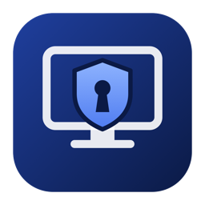

<p align="center"></p>

<h1 align="center">RDP Gate</h1>

<p align="center"><b>Windows Remote Desktop that stays closed to the internet until you sign in.</b><br>
One agent on the Windows PC. A small app on your Mac or PC. No static IP, no DNS name, no VPN.</p>

<p align="center">
<a href="https://github.com/parthh37/rdpgate/actions/workflows/ci.yml"></a>
<a href="https://github.com/parthh37/rdpgate/releases/latest"></a>
<a href="LICENSE"></a>
</p>

---

Exposing Remote Desktop (TCP 3389) to the internet invites constant password guessing and every future RDP vulnerability. RDP Gate keeps the port **closed** in Windows Firewall. When you sign in, it opens it **for your current IP address only**, keeps it open while you're connected, and closes it again when you leave.

- **Signing in** takes this computer's private key **plus** a 6-digit code from any authenticator app. You can optionally also sign in from a browser with a passkey (needs your own domain).
- **No static IP, no DNS, no DuckDNS.** The server publishes its address as an **encrypted, signed beacon** in a secret GitHub gist. The gist only ever holds ciphertext, though GitHub (like any website) sees the IP address each update comes from.
- **Spoof-resistant end to end.** Your computers pin the server's identity key, so a fake server, a hijacked address or a man-in-the-middle on the RDP port is detected *before* anything is sent or Remote Desktop opens. See [Spoofing](#spoofing).
- **One thing on the server:** `rdpgate-server.exe`, installed as a Windows service by a script that also hardens RDP and the firewall.
- **Written in Rust**, built on rustls, RustCrypto and webauthn-rs. No OpenSSL, no runtime dependencies.

Website: **https://parthh37.github.io/rdpgate/**

## How it works

```
                         secret GitHub gist
                 ┌────── "v1.<ciphertext>" ◀────── publishes {ip, port, time}
                 │       (signed by the server key,      when the IP changes
                 ▼        encrypted with the beacon key)          │
 Your Mac / PC                                         Windows PC at home
┌───────────────────────────┐  TLS 1.3 :443    ┌────────────────────────────────────┐
│ RDP Gate app              │ ───────────────▶ │ rdpgate-server (Windows service)   │
│ 1. read + decrypt beacon  │ ◀── server proves│  proves identity key first         │
│ 2. check server identity  │     its key      │  checks device signature + code    │
│ 3. device key + code      │ ───────────────▶ │  adds ONE firewall rule:           │
│ 4. check RDP certificate  │                  │   allow TCP 3389 from YOUR IP      │
│ 5. open Remote Desktop    │ ───── RDP ─────▶ │ Remote Desktop (NLA + password)    │
└───────────────────────────┘    :3389         └────────────────────────────────────┘
```

What an attacker on the internet has to get past, from the outside in:

| Layer | What it does |
|---|---|
| **Hidden** | Port 3389 is closed by default. The sign-in port answers only clients that speak the RDP Gate protocol (or browsers asking for your exact domain), limits each source to a few connections, and goes silent for sources that keep failing. |
| **Enrolled device** | Every desktop request is signed with an Ed25519 key you enrolled on the server. The signature covers the TLS 1.3 session's exported keying material, so a captured request can't be replayed or relayed. The key is stored encrypted under your passphrase (Argon2id with 64 MiB, then XChaCha20-Poly1305). |
| **Second factor** | A one-time 6-digit code (each code works once; 10 wrong codes lock that computer until you unlock it), or a passkey with fingerprint, face or PIN. |
| **One public address, for a while** | The allow rule names a single public IP. Private and carrier-NAT addresses are refused, because they can stand for many machines. The rule lasts 10 minutes if you don't connect, stays while you're connected, and is capped at 12 hours. Leftover rules are swept at every start and every few minutes. |
| **Windows itself** | Network Level Authentication, TLS-only RDP, your Windows password and an account lockout policy, all set by the installer. |

## Spoofing

| If someone… | What happens |
|---|---|
| …fakes your IP address to use your opening | The grant uses the address from a completed TCP + TLS handshake, never headers or anything the client sends. Blind TCP spoofing can't finish a handshake. UDP (no handshake) is **off** unless you enable it. |
| …runs a fake server (hijacks DNS, gets a certificate, or takes over your old IP) | Before the app sends anything, the server must sign this TLS connection's keying material with the identity key your app pinned from the server card. A fake server fails, even with a valid certificate. The app reports it and sends nothing: not even its device name or your code. |
| …forges or replays the beacon | Beacons are signed with the server key (a stolen GitHub token can't forge one) and time-stamped (the app refuses any beacon older than one it has seen). An attacker can at most delete it; the app then falls back to the last address that worked. |
| …intercepts the RDP connection after the firewall opens | The server reads its own Remote Desktop certificate and sends its fingerprint over the authenticated channel. The app checks the RDP port presents that same certificate and **refuses to launch Remote Desktop** if it doesn't. |
| …replays a sign-in | Every request is bound to one TLS connection. Each code works once. Each passkey challenge works once. |
| …phishes a passkey | Passkeys only work on your exact domain. The one remaining gap is a hijacked domain combined with a live relay, so browser sign-in is off unless you configure a domain, and the desktop app doesn't depend on DNS at all. |

## Limitations (please read)

- **Shared public IPs.** While access is open, anyone behind the same public IP (hotel Wi-Fi, an office, mobile-carrier NAT) can reach the Windows *login screen*. They still need your Windows password. Close access when you're done (button in the app, or `rdpgate lock`). The planned [tunnel mode](ROADMAP.md) removes this.
- **Not independently audited.** The building blocks are well reviewed, and RDP Gate has had an internal adversarial review (all findings fixed), but no third-party audit. `webauthn-rs 0.6.1-dev` is a pre-release (pure Rust; 0.5 needs OpenSSL).
- **Unsigned builds.** On macOS, right-click the app and choose **Open** the first time. On Windows, at the SmartScreen prompt choose **More info**, then **Run anyway**. Verify downloads with `SHA256SUMS.txt`.
- **Nothing is unbreakable.** RDP Gate removes the internet-facing attack surface. It can't protect a Windows PC that's already compromised, or a stolen laptop together with your passphrase and phone.
- **Windows Home** can't host Remote Desktop.

## Setup

You need: a Windows 10/11 **Pro, Enterprise or Education** PC, or Windows Server; admin access to your router; a GitHub account for the beacon (ideally one used only for this, see step 1); and on a Mac, Microsoft's free **[Windows App](https://apps.apple.com/app/windows-app/id1295203466)**.

### 1. Install the server

Download `RDP-Gate-<version>-Windows-Server.zip` from [Releases](https://github.com/parthh37/rdpgate/releases/latest), unzip it on the Windows PC, and in **PowerShell as Administrator** run:

```powershell
Set-ExecutionPolicy -Scope Process Bypass
.\install-server.ps1
```

It asks for a **GitHub token**: create a fine-grained token at <https://github.com/settings/personal-access-tokens/new> with **only** *Account permissions → Gists: Read and write*. The token is typed at a hidden prompt and never appears in your shell history.

**Use a GitHub account just for this.** A token with Gists access can read and change *every* gist on its account, including your other secret gists, and GitHub can't limit it to one gist. With a free account used only for the beacon, a leaked token exposes nothing else. (Secret gists are unlisted, not private: anyone with the link can read one. That's why the beacon is encrypted.)

The installer, in this order:
- installs `rdpgate-server.exe` to `C:\Program Files\RDPGate`. Its data goes in `C:\ProgramData\RDPGate`, which it takes ownership of and locks to SYSTEM and Administrators.
- sets Windows Firewall to **block inbound by default** and disables every rule that exposes the RDP port, including "any port" and port-range rules. It **stops** if Group Policy still exposes RDP.
- only then turns on Remote Desktop with NLA, TLS, high encryption and patched-CredSSP only.
- sets account lockout to 15 minutes after 10 wrong passwords (skip with `-SkipLockout`).
- creates the server identity, publishes the first beacon, and starts the `RDPGate` service.

Other options:
- `-RdpPublicPort 53389`: use an unusual external port for RDP.
- `-AllowUdp`: faster RDP, but UDP sources can be forged.
- `-ListenPort` / `-PublicPort`: use these if 443 is taken.
- `-PublicHost rdp.example.com`: enables browser sign-in with your own domain (see below).

### 2. Forward ports on your router

| External | → Windows PC | Purpose |
|---|---|---|
| TCP 443 | 443 | Sign-in |
| TCP 3389 | 3389 | Remote Desktop: closed until someone signs in |

Give the PC a fixed (reserved) LAN address in your router's DHCP settings.

### 3. Set up 6-digit codes (on the server)

```powershell
rdpgate-server totp-setup    # scan the QR code with Google/Microsoft Authenticator, 1Password, …
```

### 4. Enroll each computer you'll connect from

- **Mac:** download `RDP-Gate-<version>-macOS.zip`, move **RDP Gate.app** to Applications, and open it.
- **Windows:** download `RDP-Gate-<version>-Windows-Client.zip` and run **RDP Gate.exe**.

Enter a name for this computer and a passphrase. The app then shows a command; run it on the server:

```powershell
rdpgate-server device-add macbook rdpgate-ed25519:3q2+7w...
```

The server prints the device fingerprint (check it matches the app) and a **server card** (`rdpgate-card:…`). Paste the card into the app. The card pins the server's identity key and holds the beacon key. Keep it private: it reveals where to find your PC, though it can't sign in by itself.

### 5. Connect

- **App:** passphrase + 6-digit code → **Sign in and open Remote Desktop**. The app finds the server, verifies it, opens the firewall, checks the RDP certificate, and launches Remote Desktop.
- **Command line:** `rdpgate connect` (and `rdpgate lock` when you're done).

Test from outside your home network, for example over a phone hotspot. To sign in from inside your own network, set `"allow_private_sources": true` (see below).

### Optional: browser sign-in with a passkey

Browsers bind passkeys to a domain name, never an IP, so this needs a domain you control that points at your home IP. Run `.\install-server.ps1 -PublicHost rdp.example.com` (or `rdpgate-server init --force --host rdp.example.com`), restart the service, then add a passkey:

```powershell
rdpgate-server passkey-enroll   # one-time link: open it on your Mac/iPhone/PC
```

The sign-in page shows which IP it opened, lets you close access early, and shows the Remote Desktop certificate fingerprint to compare.

## Administration

```text
rdpgate-server status                  # identity, beacon, warnings, open firewall grants
rdpgate-server card                    # print the server card again
rdpgate-server device-list | device-remove NAME | device-unlock NAME
rdpgate-server passkey-list | passkey-remove NAME
rdpgate-server beacon-setup            # new token or gist
rdpgate-server totp-setup --force      # new authenticator secret
```

Logs: `C:\ProgramData\RDPGate\logs\rdpgate.log`. Every refusal (`DENY`), sign-in (`GRANT open`), RDP connection, lockout, beacon update and closure is recorded.

Settings live in `C:\ProgramData\RDPGate\config.json`; restart the service after editing (`Restart-Service RDPGate`):

| Key | Default | Meaning |
|---|---|---|
| `public_port` | 443 | External port forwarded to the agent |
| `listen` | `["0.0.0.0:443"]` | Add `"[::]:443"` for IPv6 |
| `rdp_port` / `rdp_public_port` | 3389 | Local RDP port / external port clients use |
| `allow_udp` | false | Also open UDP for signed-in addresses |
| `allow_private_sources` | false | Grant LAN / carrier-NAT source addresses |
| `grant_minutes` | 10 | Time to start a session after signing in |
| `max_hours` | 12 | Hard cap on one grant |
| `desktop_login` / `web_login` | true / with domain | Turn either sign-in method off |
| `public_host`, `tls` | — | Domain and certificate for browser sign-in |
| `beacon` | — | `{ "gist_id": …, "token": … }`, set by `beacon-setup` |

Uninstall: `& "C:\Program Files\RDPGate\uninstall-server.ps1"` (add `-RemoveData` to delete settings).

## Troubleshooting

- **"answered but is NOT your server"**: something other than your server answered at that address. If the server was reinstalled (new identity), paste the new server card. Otherwise, treat it as a spoofing attempt.
- **"The server refused this computer"**: the device isn't enrolled, or your IP is temporarily blocked after repeated failures.
- **"this computer is locked after too many wrong codes"**: run `rdpgate-server device-unlock NAME` on the server.
- **"is not a public address"**: you signed in from your own network. Either test from outside, or set `allow_private_sources`.
- **Beacon errors in `status`**: check the GitHub token still has Gists access (`rdpgate-server beacon-setup` to replace it).
- **Microsoft account with "passwordless" sign-in**: RDP needs a password. Turn off "Require Windows Hello sign-in for Microsoft accounts", or use a local account.

## Building from source

```bash
cargo test --workspace
cargo build --release -p rdpgate-server -p rdpgate-client -p rdpgate-app
./scripts/build-release.sh        # macOS: builds every package into dist/ (needs cargo-xwin for Windows)
```

| Crate | |
|---|---|
| `crates/rdpgate-core` | Wire protocol (Ed25519 + TLS channel binding), beacon & server card, RDP certificate probe, TOTP, encrypted key file |
| `crates/rdpgate-server` | The Windows agent: TLS, beacon publisher, passkey portal, firewall grants, service |
| `crates/rdpgate-client` | Client library and the `rdpgate` command-line tool |
| `crates/rdpgate-app` | The desktop app (egui) for macOS and Windows |

## Roadmap

See [ROADMAP.md](ROADMAP.md). Next up: **tunnel mode** (RDP through the authenticated connection, with no port 3389 forwarding and no shared-IP exposure), signed builds, and privilege separation.

## Security

Please report vulnerabilities privately; see [SECURITY.md](SECURITY.md).

## License

[MIT](LICENSE)
